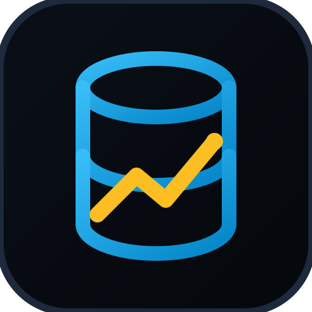
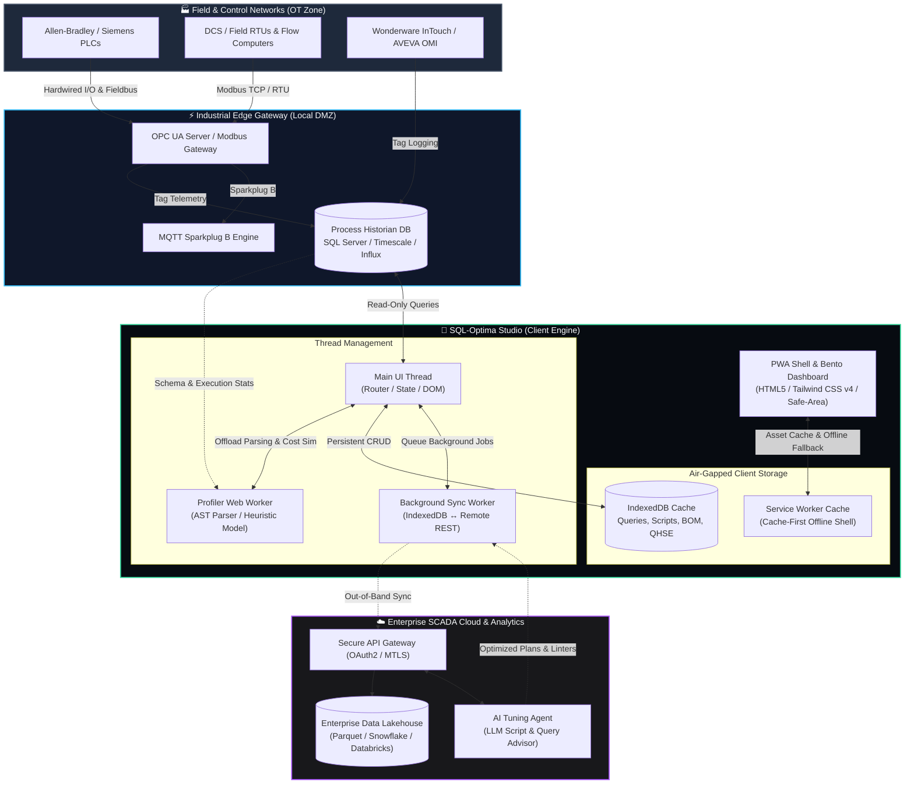

<div align="center">



# SQL-Optima Studio ⚡

### Industrial SCADA Historian Query Profiler & Script Tuning Workbench

[](https://githubbest729.github.io/SQL-Optima-Studio/)
[](LICENSE)
[](js/profiler.worker.js)
[](sw.js)
[](styles.css)

**[🚀 Launch Live Application](https://githubbest729.github.io/SQL-Optima-Studio/)**

---

<p align="center">
  <b>SQL-Optima Studio</b> is a mission-critical 2026 Progressive Web App (PWA) built specifically for <b>SCADA, Instrumentation & Control, and Automation Engineers</b>.<br>
  Tailored for optimizing high-frequency industrial historians (AVEVA / Wonderware InTouch & System Platform, GE iFIX, Rockwell FactoryTalk, Ignition, and SQL Server / TimescaleDB databases) across heavy industries like Oil & Gas, Water/Wastewater, District Cooling, and Continuous Manufacturing.
</p>

</div>

---

## 📑 Table of Contents

- [Key Features](#-key-features)
- [Industrial Sector Profiles](#-industrial-sector-profiles)
- [Future System Architecture](#-future-system-architecture)
- [Repository File Manifest](#-repository-file-manifest)
- [PWA Design & Control-Room Standards](#-pwa-design--control-room-standards)
- [Engineering Responsibilities Addressed](#-engineering-responsibilities-addressed)
- [Getting Started & Deployment](#-getting-started--deployment)
- [Keyboard Shortcuts](#-keyboard-shortcuts)
- [Social & Community](#-social--community)
- [Disclaimer & License](#-disclaimer--license)

---

## ⚡ Key Features

- **🚀 Heuristic Query Profiler & Execution Plan Analyzer**:
  - Off-thread execution plan simulation using a dedicated Web Worker (`profiler.worker.js`).
  - Mathematical modeling of Index Seek vs. Table Scan ratios, Logical/Physical I/O cost, CPU time, and Memory Grant spikes.
  - Specialized parsing for Industrial Historian schemas (bracketed tags `Runtime.dbo.History`, `wwResolution`, `wwRetrievalMode`, half-open timestamp range enforcement).
  - Safe automated SQL rewrite engine and automated DDL recommendations (Partition Schemes, Clustered Columnstore Indexes, Continuous Aggregates).
- **🛠️ Multi-Language Script Workbench**:
  - Full IDE environment with real-time syntax highlighting for **Wonderware InTouch QuickScripts**, **C# (.NET Historian Fetch utilities)**, **SQL Maintenance jobs**, and **Shell/cron automations**.
  - Built-in linting engine checking for unhandled `SQLConnect` leaks, missing `SQLEnd`, raw string concatenations, unbalanced conditional blocks, and cron expression syntax errors.
  - Interactive test execution console with simulated real-time logs and telemetry back-off simulation.
- **🔍 Control-Room Error Code Lookup**:
  - Instant offline reference library for troubleshooting:
    - **SQL Server**: Deadlock victim (1205), Lock timeout (1222), CommandTimeout (-2), Log full (9002).
    - **Oracle**: Deadlock (ORA-00060), Snapshot too old (ORA-01555), TNS listener (ORA-12541).
    - **PostgreSQL / TimescaleDB**: `40P01` (deadlock), `57014` (statement_timeout).
    - **OPC UA**: `0x800A0000` (BadTimeout), `0x80050000` (BadCommunicationError), `0x80340000` (BadNodeIdUnknown), `0x801A0000` (Untrusted Certificate).
    - **Modbus Protocol**: Exception 01 (Illegal Function), 02 (Illegal Address), 03 (Illegal Data Value), 04 (Slave Failure), 0B (Gateway Failure).
    - **InTouch**: SQL Access Manager error codes and connection diagnostics.
- **📊 BOM & Project Costing Hub**:
  - Live Bill of Materials (BOM) estimator for industrial historian integrations (Hardware, Database Licensing, Engineering Hours, SAT/FAT commissioning).
  - Customizable markup, contingency, and tax/VAT calculators with real-time currency conversions and CSV export.
- **🛡️ QHSE Compliance Engine**:
  - Standardized Management-of-Change (MoC) verification gates covering Quality, Health, Safety, and Environment for plant database engineers.
  - Industry-specific compliance items (ATEX/IECEx hazardous-area safety, HACCP data integrity, environmental emissions monitoring).
- **📱 2026 PWA Core**:
  - True offline-first operation backed by browser IndexedDB and Cache-First Service Worker caching.
  - Glare-free Control Room Dark themes with Bento-grid layouts, WCAG AA contrast compliance, and touch-target sizing (≥44px) for rugged industrial tablets.

---

## 🏭 Industrial Sector Profiles

The studio includes tailored optimization heuristics and advice for primary continuous process sectors:

| Sector | Primary Optimization Focus | Control Room Tip |
| :--- | :--- | :--- |
| **🛢️ Oil & Gas** | Custody transfer immutability, redundant failover | Segregate safety systems (SIS) from the historian; replicate alarm history to read-only reporting nodes. |
| **💧 Water / Wastewater** | Pump station downsampling, regulatory reporting | Replace high-rate raw tag scans with 15-min / daily rollup tables and continuous aggregates. |
| **❄️ District Cooling** | Energy balance (kW/TR, ΔT), chiller performance | Index on `(PlantId, TagName, DateTime)`. Eliminate `CONVERT(date, ...)` wrappers on high-traffic daily logs. |
| **⚙️ Metals & Minerals** | Mill vibration, high-frequency logging (100 ms) | Implement Clustered Columnstore and table compression; retain 7–14 days raw and downsample older data. |
| **🍞 Food & Beverages** | Batch genealogy, FDA 21 CFR Part 11 / HACCP audits | Partition tables across batch windows; ensure immutable audit logs and e-signatures. |
| **🏢 Infrastructure** | Smart city building automation, tunnel monitoring | Utilize tag-group lookup dictionaries instead of broad `LIKE '%...'` wildcard searches. |

---

## 🏗️ Future System Architecture

The following diagram illustrates the planned hybrid edge-to-cloud architecture for future releases of SQL-Optima Studio, integrating direct industrial protocol drivers (OPC UA / MQTT Sparkplug B) with containerized edge analytics and cloud synchronization:



---

## 📂 Repository File Manifest

The repository maintains a flat, zero-build-step structure ready for immediate deployment on **GitHub Pages**, local web servers, or industrial intranet kiosks:

```
SQL-Optima-Studio/
├── app.js                 # Application controller, IndexedDB persistence, hash router, telemetry simulation
├── components.js          # Reusable UI component library (Bento cards, gauges, charts, code editor, tree view)
├── icons.js               # Embedded inline SVG system (SCADA equipment, tools, and social brand glyphs)
├── profiler.worker.js     # Background Web Worker running AST analysis, query execution plan simulation, and DDL engine
├── index.html             # High-performance PWA entry shell with safe-area support and PWA meta tags
├── styles.css             # Control-room dark theme tokens, glassmorphism, responsive grid, and typography
├── manifest.webmanifest   # Web App Manifest defining standalone display, app shortcuts, and color specifications
├── sw.js                  # Service Worker managing Cache-First static caching and offline request interception
├── offline.html           # Dedicated offline fallback view for field operations without network connection
├── icon.svg               # Vector brand master icon (industrial database cylinder with telemetry line)
├── favicon.svg            # Scalable browser tab favicon
├── robots.txt             # Web crawler indexing rules and sitemap pointer
└── README.md              # Comprehensive technical documentation and user guide
```

---

## 🎨 PWA Design & Control-Room Standards

Built with strict adherence to industrial Human-Machine Interface (HMI) guidelines and modern PWA best practices:

1. **Fluid Responsive Layout**: Mobile-first design that naturally adapts from 320px smartphones to 4K multi-monitor control desks.
2. **Control Room Ergonomics**: Glare-reducing dark backgrounds (`#070b11`, `#0f1420`, `#0a0804`) designed to prevent operator eye fatigue during 12-hour shifts.
3. **Rugged Touch Compliance**: Touch targets exceed minimum requirements (≥44×44px) with ample spacing to accommodate gloves and ruggedized touchscreens.
4. **Hardware Notches & Safe Areas**: Seamless integration with iOS and Android display cutouts using `env(safe-area-inset-*)`.
5. **Zero Main-Thread Freezing**: Intensive query simulation operations execute entirely off-thread via `WorkerGlobalScope`.

---

## 🎯 Engineering Responsibilities Addressed

This toolkit directly supports the standard operational scope of a SCADA Engineer:

- **Query Optimization**: Replaces unindexed table scans on tag historians with half-open range queries and columnstore architectures.
- **Script Development**: Rapidly drafts and lints InTouch QuickScripts, C# data adapters, and automated shell reporting scripts.
- **Protocol Diagnostics**: Provides instant lookup for Modbus exceptions, OPC UA timeouts, and database engine lockups.
- **Project Governance**: Automates BOM generation, engineering estimations, and QHSE compliance checklists.

---

## 🚀 Getting Started & Deployment

### Quick Local Run

Because SQL-Optima Studio uses standard web technologies without external compiler dependencies, you can serve it locally using any static web server:

```bash
# Using Python 3
python -m http.server 8080

# Or using Node npx
npx serve .
```

Open `http://localhost:8080` in your browser.

### Deploying to GitHub Pages

1. Clone or push the repository files directly to the root of your GitHub repository (`githubbest729/SQL-Optima-Studio`).
2. Navigate to **Settings** > **Pages** in your GitHub repository.
3. Under **Build and deployment** > **Source**, choose **Deploy from a branch**.
4. Set the branch to `main` (or `master`) and folder to `/ (root)`.
5. Click **Save**. Your PWA is live at `https://<username>.github.io/<repo-name>/`.

---

## ⌨️ Keyboard Shortcuts

| Shortcut | Action |
| :--- | :--- |
| <kbd>Ctrl</kbd> / <kbd>⌘</kbd> + <kbd>K</kbd> | Open Command Palette (navigate views, run actions, switch themes) |
| <kbd>Ctrl</kbd> / <kbd>⌘</kbd> + <kbd>Enter</kbd> | Profile currently edited SQL query or run script simulation |
| <kbd>Ctrl</kbd> / <kbd>⌘</kbd> + <kbd>S</kbd> | Save script / query to local IndexedDB |
| <kbd>Tab</kbd> | 2-space soft indent inside code editor |
| <kbd>Esc</kbd> | Close open modals, search overlays, or mobile navigation drawers |

---

## 🌐 Social & Community

Connect with industrial automation peers, follow project updates, and share query profiles:

<p align="left">
  <a href="https://www.linkedin.com/" target="_blank" rel="noopener noreferrer">
    
  </a>
  &nbsp;
  <a href="https://github.com/githubbest729/SQL-Optima-Studio" target="_blank" rel="noopener noreferrer">
    
  </a>
  &nbsp;
  <a href="https://www.youtube.com/" target="_blank" rel="noopener noreferrer">
    
  </a>
  &nbsp;
  <a href="https://x.com/" target="_blank" rel="noopener noreferrer">
    
  </a>
</p>

---

## 📜 Disclaimer & License

> **Engineering Notice**: Performance metrics, cost units, and execution plan trees generated by SQL-Optima Studio are heuristic simulations designed for engineering estimation and learning. Always test schema adjustments, index builds, and script rewrites in a staging environment and follow your facility's official Management of Change (MoC) policies before deploying to production historians.
> 
> *Wonderware, AVEVA, InTouch, System Platform, GE iFIX, FactoryTalk, and other registered trademarks belong to their respective corporate entities. SQL-Optima Studio is an independent open-source engineering utility.*

Distributed under the **MIT License**. See `LICENSE` for more information.
